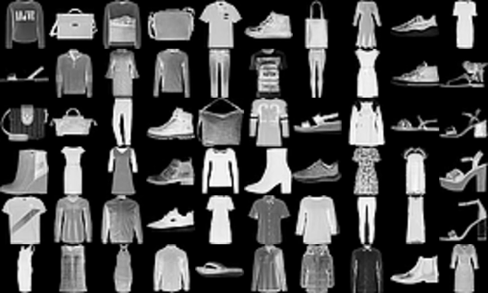

# Fashion-MNIST ResNet with a Custom Training Loop

A residual network built from custom Keras layers and the model subclassing API, trained on Fashion-MNIST with a hand-written training loop based on `tf.GradientTape`.


## Overview

This project builds a small ResNet-style classifier from scratch and trains it without `model.fit()`:
two custom residual layers, a custom `Model` subclass that stacks them, and a custom training loop
where the gradients are computed with TensorFlow's automatic differentiation and applied to the
weights by hand. The trained model is then evaluated on unseen images and its predictions are
inspected visually.

The network reaches **82.76% accuracy on the 10,000 test images** after training on only 5,000 images
for 8 epochs.

Everything lives in a single notebook: [`tf2-Classifier-fashion-mnist-custom-training-loop.ipynb`](tf2-Classifier-fashion-mnist-custom-training-loop.ipynb)

## Dataset



The [Fashion-MNIST](https://github.com/zalandoresearch/fashion-mnist) dataset, a drop-in replacement
for MNIST made of clothing items from Zalando:

|  |  |
|---|---|
| Training set | 60,000 images (only the first 5,000 are used here) |
| Test set | 10,000 images |
| Image format | 28x28 grayscale, pixel values 0-255 |
| Classes | 10: T-shirt/top, Trouser, Pullover, Dress, Coat, Sandal, Shirt, Sneaker, Bag, Ankle boot |
| Task | multi-class image classification |

Preprocessing scales the pixels to `[0, 1]` and adds a channel axis, so each image becomes a
`(28, 28, 1)` tensor. The data is served in batches of 32 through `tf.data.Dataset`.

## Model

Two custom `Layer` subclasses are combined inside a custom `Model`:

- **`ResidualBlock`**: batch norm, ReLU and a 3x3 convolution, twice, with the input added back through a skip connection. Input and output shapes are identical.
- **`FiltersChangeResidualBlock`**: same idea, but the last 3x3 convolution outputs a different number of filters and the shortcut goes through a 1x1 convolution so the addition stays valid.

| Layer | Configuration | Output shape |
|-------|---------------|--------------|
| `Conv2D` | 32 filters 7x7, stride 2 | (11, 11, 32) |
| `ResidualBlock` | 32 filters | (11, 11, 32) |
| `Conv2D` | 32 filters 3x3, stride 2 | (5, 5, 32) |
| `FiltersChangeResidualBlock` | 64 output filters | (5, 5, 64) |
| `Flatten` | - | (1600,) |
| `Dense` | 10 units, softmax | (10,) |

## Custom training loop

- **Optimizer and loss:** Adam (learning rate 0.001) and sparse categorical cross-entropy.
- **`grad` function:** the forward pass and the loss run inside a `tf.GradientTape`, and `tape.gradient` returns the gradients for every trainable variable. It is compiled with `@tf.function`.
- **Loop:** for each batch the gradients are applied with `optimizer.apply_gradients`, while a `Mean` and a `SparseCategoricalAccuracy` metric track the loss and accuracy of the epoch.
- **Training:** 8 epochs, batch size 32, on 5,000 images.

## Workflow

1. **Load** — Fashion-MNIST downloaded through Keras.
2. **Preprocess** — first 5,000 training images, `[0, 1]` scaling and channel axis.
3. **Build** — the two residual layers, each checked with a small `Sequential` model and its summary.
4. **Assemble** — the `ResNetModel` subclass that stacks them.
5. **Train** — custom loop with `tf.GradientTape`, 8 epochs.
6. **Learning curves** — loss and accuracy per epoch.
7. **Evaluate** — loss and accuracy on the 10,000 test images.
8. **Predict** — probability distributions for four random test images.

## Results

| Set | Images | Loss | Accuracy |
|-----|-------:|-----:|---------:|
| Training (epoch 8) | 5,000 | 0.167 | 91.38% |
| Test | 10,000 | 0.661 | **82.76%** |

Training accuracy goes from 21.8% in the first epoch to 91.38% in the eighth, with the loss falling
from 0.684 to 0.167.

## Key takeaways

- **The custom loop works.** Loss falls and accuracy rises epoch after epoch, confirming the gradients from `tf.GradientTape` and the manual `apply_gradients` step do their job without `model.fit()`.
- **The model overfits.** Training accuracy is almost 9 points above test accuracy and the test loss is about four times the training loss. Training on just 5,000 of the 60,000 images is the most likely cause.
- **Residual blocks train quickly.** About 87% training accuracy is reached by the fourth epoch.
- **Confident predictions.** On the random samples shown, nearly all the probability goes to one class, but the 82.76% test accuracy is the number that tells how reliable the model really is.

## Project structure

```
.
├── data/                                                    # Image used in the notebook
├── src/tf2_classifier_fashion_mnist_custom_training_loop/   # Package scaffold
├── tf2-Classifier-fashion-mnist-custom-training-loop.ipynb  # Main notebook
├── pyproject.toml                                           # Dependencies (uv project)
└── uv.lock                                                  # Pinned versions
```

## Getting started

The project is managed with [uv](https://docs.astral.sh/uv/) and requires Python 3.11+.

```bash
# Clone the repository
git clone https://github.com/ramirezgrosas/tf2-Classifier-fashion-mnist-custom-training-loop.git
cd tf2-Classifier-fashion-mnist-custom-training-loop

# Create the virtual environment and install the dependencies
uv sync
```

Then open the notebook in VS Code and select `.venv` as the kernel, or launch Jupyter directly:

```bash
uv run --with jupyter jupyter lab
```

The dataset is downloaded automatically by Keras the first time the notebook runs.

Main dependencies: TensorFlow 2.21 (Keras 3.15), NumPy and Matplotlib.

## Possible improvements

- Train on the full 60,000-image training set to reduce the overfitting gap.
- Hold out a validation set to follow generalisation at every epoch.
- Add data augmentation and regularisation such as dropout or weight decay.
- Build a confusion matrix to find which classes the model confuses most (probably shirt, T-shirt/top, pullover and coat).

## Author

**Diego Ramírez Rosas** — [ramirezgrosas](https://github.com/ramirezgrosas)
